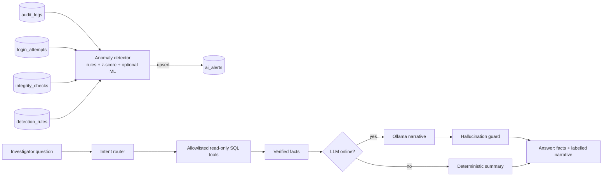

# AI Architecture

AI in SQL Ghost Hunter is an **intelligence layer on top of SQL**. It reads the forensic data that MySQL already holds and helps an investigator find and understand suspicious patterns. It never writes SQL, never modifies evidence and never replaces the database rules.



## 1. Anomaly detection (`backend/app/ai/detector.py`)

Three kinds of detection, always labelled in the UI:

| Label | Meaning | Trained? |
|---|---|---|
| **RULE** | deterministic rule, threshold from `detection_rules` | no training |
| **STATISTICAL** | z-score against a baseline computed from the data | no training (descriptive statistics) |
| **ML** | IsolationForest, unsupervised, optional (scikit-learn) | fitted on the current activity data at each run; **no labelled attack data, no saved model** |

### Detectors

| Rule code | Detects | Default threshold / window |
|---|---|---|
| INTEGRITY_FAILURE | SHA-256 verification produced a different hash, or the file is missing | 1 failure |
| REPEATED_DELETE | same actor deleted many records | 3 in 60 min |
| BULK_UPDATE | same actor made many UPDATEs (verification refreshes ignored) | 10 in 30 min |
| FAILED_LOGINS | password guessing; bonus if followed by a successful login from the same IP | 5 in 15 min |
| OFF_HOURS_ACTIVITY | data changes, downloads or logins outside working hours | outside 08:00-20:00 |
| DIRECT_DB_CHANGE | changes made with **no application identity** (someone used MySQL directly) | 1 in 60 min |
| SENSITIVE_MODIFICATION | evidence metadata edits, role changes, rule changes/disabling, dismissal of high alerts | each event |
| REPEATED_RECORD_CHANGE | the same record changed several times | 3 in 60 min |
| EVIDENCE_ACCESS_BURST | many evidence downloads; bonus for several cases or preceding failed logins | 4 in 30 min |
| HIGH_ACTIVITY_ZSCORE (statistical) | an actor's operations in one hour far above the population of actor-hours (leave-one-out mean/std) | z >= 3, min 5 operations |
| ISOLATION_FOREST (ML, optional) | unusual combination of features per actor-hour: operations, deletes, updates, downloads, logins, high-risk events, tables touched, off-hours | contamination 5 %, >= 20 samples |

"Operations" counts distinct timestamps per actor, because one user action (e.g. registering evidence) writes several audit rows at the same instant.

Each rule groups events by actor (investigator, or the MySQL account when unidentified) and builds time clusters no longer than the window. Clusters reaching the threshold become findings.

## 2. Risk assessment (explainable and configurable)

Score = base score of the rule + additional factors, capped at 100. Each finding stores its **score breakdown** in `ai_alerts.supporting_facts.score_breakdown`, displayed under every alert:

```
CRITICAL: 7 data change(s) made directly in MySQL as 'root@localhost' with no application login,
between 02:40 and 02:55: UPDATE cases x3, DELETE case_assignments x3, UPDATE evidence x1.
Risk score 95/100 = rule DIRECT_DB_CHANGE base score (+60); 7 changes in the session (+15);
includes HIGH/CRITICAL changes (+10); outside working hours 08:00-20:00 (+10).
```

Common factors: amount above threshold, no application identity (+15), outside working hours (+10), several cases involved (+10), preceded by failed logins (+15), successful login after guessing (+20), file restored (-40).

Severity bands (same as SQL `fn_risk_level`): 0-34 LOW, 35-59 MEDIUM, 60-84 HIGH, 85-100 CRITICAL.
**Case risk** (`fn_case_risk_score`) = highest open alert score + 5 per additional open alert.

**Configurable:** thresholds, windows, base scores, enabled flags and working hours are rows in `detection_rules`, editable by an ADMIN on the *Detection rules* tab (changes are themselves audited; disabling a detector is a HIGH-risk event).

**Two levels of risk** exist and are different on purpose:
- `audit_logs.risk_level` - assigned instantly by the trigger to a single event (e.g. any DELETE on evidence = HIGH).
- `ai_alerts.risk_score` - assigned by the detector to a *pattern* of events with an explanation.

**Wording:** every explanation ends with "This is an indicator for review, not proof of malicious activity." Alerts have a review workflow (Acknowledge / Escalate / Dismiss) recorded with reviewer and time.

**Idempotent:** a fingerprint (rule + subject + first event) means re-running analysis updates the same alert instead of duplicating it.

## 3. Forensic assistant (`backend/app/ai/assistant.py`)

1. **Route** the question to one of the allowlisted intents with regular expressions: `suspicious_activity`, `failed_verification`, `record_history`, `recent_changes`, `why_flagged`, `case_summary`, `custody_history`, `highest_risk_case`, `failed_logins`, `investigator_activity`, `help`. If no rule matches and the LLM is online, the LLM may choose an intent - its JSON reply is validated and anything outside the list is ignored.
2. **Retrieve** with that intent's fixed, parameterised, read-only queries (views such as `vw_case_summary`, `vw_audit_trail`, `vw_custody_history`). INVESTIGATOR users only see their cases (`fn_has_case_access`).
3. **Answer**:
   - *Verified facts* - lines built directly from MySQL rows, always shown, with the source tables.
   - *Narrative* - if the LLM is online it rewrites only the facts (system prompt: use only the facts, never invent, say "suspicious", max 170 words); otherwise a deterministic template summary.
4. **Guard** - case codes, evidence codes and `#ids` in the LLM narrative that do not appear in the facts are reported as warnings.
5. **Audit** - every question is logged as `AI_QUERY`.

Example questions supported: *What suspicious activities happened today? Which evidence files failed verification? Who modified evidence 2? What was changed? Why was alert 6 flagged? Summarize the suspicious activities in Case 001. Show the custody history of EV-0001. Which investigation currently has the highest risk? What did Rahul do yesterday? Show failed logins this week.*

**Never allowed:** arbitrary SQL from the LLM or the user, database credentials in prompts, write operations from the assistant.

## 4. Investigation report generator (`services/reports.py`)

Sections: case details, team, evidence with original/latest hashes, integrity history, chain of custody, risk assessments with explanations, audit timeline (MEDIUM and above), **suggested investigation steps** (deterministic rules - e.g. TAMPERED evidence -> preserve altered copy, obtain fresh copy, review file-system access between last good and first failed check) and an optional **AI-generated narrative** clearly labelled with a disclaimer. Formats: JSON, Markdown (download), printable HTML.

## 5. Offline fallback

| Component | LLM online | LLM offline |
|---|---|---|
| SQL features, auditing, evidence, custody | work | work |
| Anomaly detection & risk scores | work | work (no LLM involved) |
| Assistant | facts + AI narrative | facts + deterministic summary |
| Reports | facts + rules + AI narrative | facts + rules, narrative marked "not generated" |
| Status | "LLM online" pill, model name | "LLM offline" pill with reason (server down / model not pulled) |

Status is checked with a 2-second request to `GET /api/tags` and cached for 20 s; a failed chat request falls back immediately. No paid API or internet connection is required.

## 6. Limitations (honest)

- Rules see only what is recorded: file-system edits are invisible until someone verifies the hash; privileged MySQL users can disable triggers (see SECURITY.md).
- Thresholds are heuristics; normal but unusual work (e.g. a late-night emergency) will be flagged and should be acknowledged by a reviewer.
- The z-score and IsolationForest need enough history; with very little data they produce no findings (by design) or unstable ones.
- IsolationForest is unsupervised and fitted on the current data - it is not a validated intrusion-detection model and is labelled as such.
- LLM narratives can still be wrong in wording even with the guard; the facts section is the authoritative part.
- The LLM path was tested with an HTTP stand-in that speaks the Ollama API (see TEST_RESULTS.md); output quality depends on the model you install.
