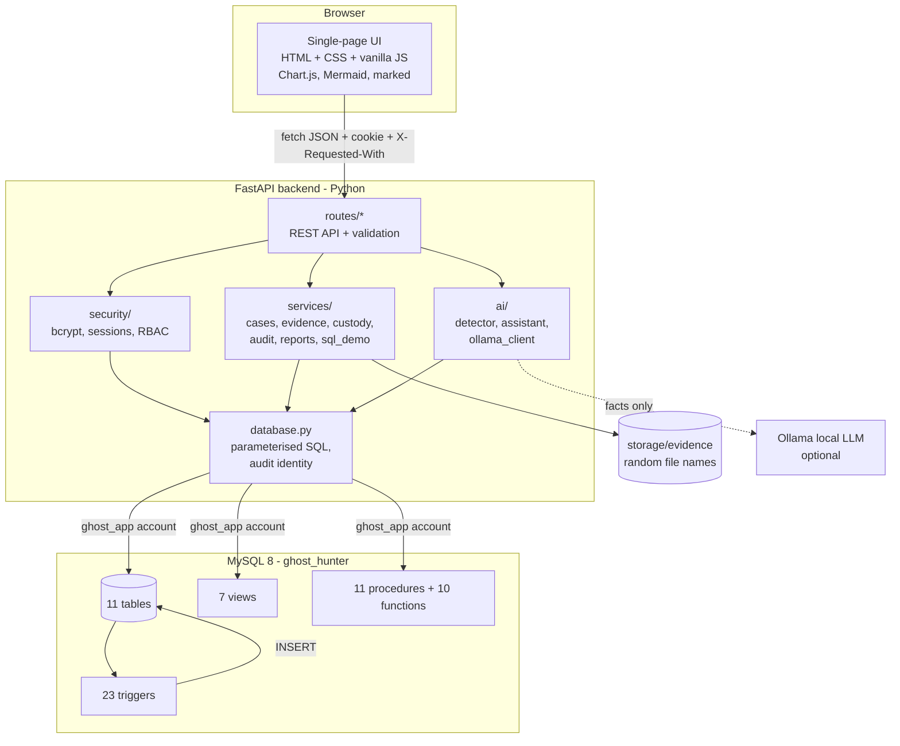
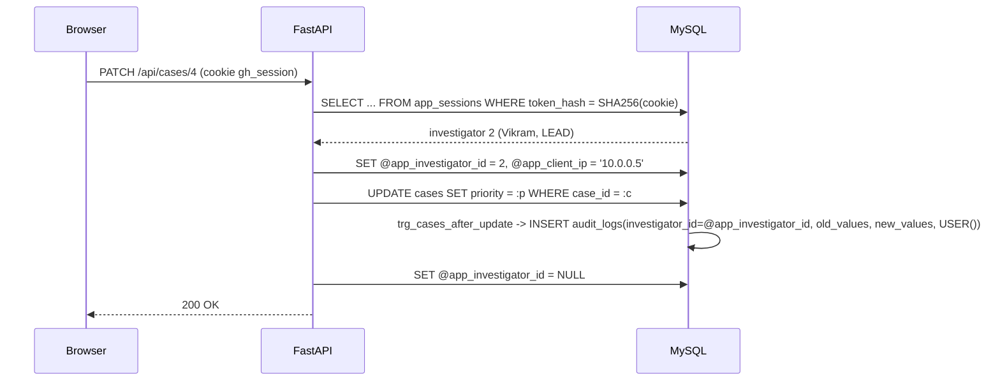

# Architecture

## 1. Components

| Layer | Responsibility |
|---|---|
| **MySQL** | the system of record. Business rules that protect evidence live here: constraints, procedures (authorisation, transactions), triggers (audit + immutability). |
| **database.py** | one SQLAlchemy engine using the least-privilege account `ghost_app`; every query uses bound parameters; `identity()` sets `@app_investigator_id` and `@app_client_ip` for the triggers and clears them afterwards. |
| **security/** | password hashing, session lookup, role permissions, case-access checks. |
| **services/** | use-case logic: e.g. evidence upload = validate + store + hash + `CALL sp_register_evidence`. |
| **ai/** | detector (rules, statistics, optional ML), forensic assistant (allowlisted tools), Ollama client with offline detection. |
| **frontend/** | 8 pages, no framework, no inline scripts (strict Content-Security-Policy). |

## 2. How the investigator identity reaches the audit log

The browser never sends an investigator id that is trusted; identity comes from the server-side session table. If somebody changes data directly in MySQL, `@app_investigator_id` is NULL, so the audit row shows *UNIDENTIFIED (outside application)* together with the real MySQL account (`USER()`), and the risk is escalated.

## 3. Main workflows

### Evidence registration
1. User selects case + file (`POST /api/evidence`, multipart).
2. `utils/files.store_upload`: extension allowlist, size limit, magic-byte content check, streaming write to `storage/tmp` **while computing SHA-256**, atomic move to `storage/evidence/<uuid>.<ext>`, file made read-only.
3. `CALL sp_register_evidence(...)` - one transaction: evidence row (original_hash = current_hash), initial custody row (acquired by uploader), baseline integrity check.
4. Triggers write three `INSERT` audit rows. If the procedure fails, the stored file is deleted.

### Integrity verification
1. `POST /api/evidence/{id}/verify` recomputes SHA-256 of the stored file (NULL if missing).
2. `CALL sp_record_integrity_check` compares with `original_hash` (never modified), appends an `integrity_checks` row and refreshes the cached status - one transaction.
3. On TAMPERED/MISSING the detector immediately creates/updates a CRITICAL `INTEGRITY_FAILURE` alert.

### Custody transfer
`POST /api/custody/transfer` -> hash recomputed -> `CALL sp_transfer_custody` checks: performer is current custodian or LEAD/ADMIN; receiver active, not auditor, assigned to the case. Then, in one transaction, an integrity check and the custody row (with `hash_at_transfer` and `verification_status`) are appended.

### Anomaly detection
Runs at start-up, every `AUTO_ANALYSIS_MINUTES`, and on demand. Reads `audit_logs`, `login_attempts`, `integrity_checks` and `detection_rules`, applies 11 detectors, and upserts `ai_alerts` by fingerprint (idempotent).

### Forensic assistant
Question -> intent router (regex; LLM may only choose from the allowlist) -> fixed read-only SQL for that intent with case-access filter -> verified facts + deterministic summary or LLM narrative -> hallucination guard -> `AI_QUERY` audit event.

## 4. REST API overview

| Area | Endpoints |
|---|---|
| Auth | `POST /api/auth/login`, `POST /api/auth/logout`, `GET /api/auth/me` |
| Dashboard | `GET /api/dashboard` |
| Cases | `GET/POST /api/cases`, `GET/PATCH/DELETE /api/cases/{id}`, `POST /api/cases/{id}/status`, `POST /api/cases/{id}/assignments`, `DELETE /api/cases/{id}/assignments/{inv}` |
| Investigators | `GET/POST /api/investigators`, `PATCH /api/investigators/{id}` |
| Evidence | `GET/POST /api/evidence`, `GET /api/evidence/{id}`, `POST /api/evidence/{id}/verify`, `POST /api/evidence/verify-all`, `GET /api/evidence/{id}/download` |
| Custody | `GET /api/custody`, `GET /api/custody/{evidence_id}`, `POST /api/custody/transfer` |
| Audit | `GET /api/audit` (filters + paging), `GET /api/audit/options`, `GET /api/audit/{log_id}` |
| AI | `GET /api/ai/status`, `POST /api/ai/analyze`, `GET /api/ai/alerts`, `PATCH /api/ai/alerts/{id}`, `GET /api/ai/rules`, `PATCH /api/ai/rules/{code}`, `GET /api/ai/case-risk`, `POST /api/ai/assistant` |
| Reports | `GET /api/reports/case/{id}?format=json|md|html&ai=true|false` |
| SQL demo | `GET /api/sql/catalog`, `POST /api/sql/run/{query_id}`, `GET /api/sql/tables`, `GET /api/sql/scripts/{name}` |
| Docs / health | `GET /api/docs`, `GET /api/docs/{name}`, `GET /api/health` |

Interactive documentation: `/api-docs`.

## 5. Design decisions

| Decision | Reason |
|---|---|
| Business-critical writes in stored procedures | the rules hold even if another client (not this backend) uses the database; the app account has no direct write privilege on history tables |
| SQLAlchemy Core with SQL text instead of an ORM | the SQL stays visible and explainable for a DBMS course |
| AUTOCOMMIT connections + procedure-level transactions | avoids nested-transaction surprises; each procedure is atomic on its own |
| Server-side sessions instead of JWT | logout and account deactivation take effect immediately; identity is always looked up in MySQL |
| Rule engine first, LLM optional | deterministic and explainable results; the system works fully offline |
| Libraries bundled locally | the demo works on a university network without internet |
