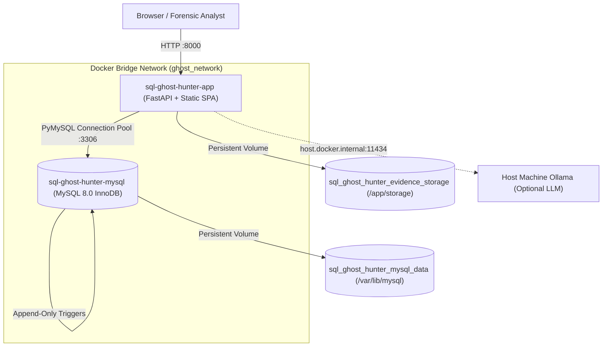

# Docker Deployment & Operation Guide

**SQL Ghost Hunter** is fully containerized for single-command production and development deployments using **Docker** and **Docker Compose**.

---

## 1. Quick Start (1-Command Run)

Make sure [Docker Desktop](https://www.docker.com/products/docker-desktop/) or Docker Engine is installed and running on your system.

```bash
# Clone the repository
git clone https://github.com/your-username/sql-ghost-hunter.git
cd sql-ghost-hunter

# Start MySQL and FastAPI with automatic database initialization
docker compose up --build -d
```

Once the containers start up and pass health checks, open your browser:
- **Application URL:** [http://localhost:8000](http://localhost:8000)
- **API Swagger Documentation:** [http://localhost:8000/api-docs](http://localhost:8000/api-docs)
- **System Health Diagnostics:** [http://localhost:8000/api/health](http://localhost:8000/api/health)

To view live container logs:
```bash
docker compose logs -f app
```

To stop the services:
```bash
docker compose down
```

---

## 2. Container Architecture



The Docker deployment isolates all components:
1. **`sql-ghost-hunter-mysql` (Database):** Official MySQL 8.0 image with UTF8MB4 charset, persistent storage volume, and automated health checks.
2. **`sql-ghost-hunter-app` (Forensics Engine):** Lightweight Python 3.11-slim container running as a non-privileged system user (`ghosthunter`, UID 1000). The automated entrypoint script waits for MySQL readiness, runs schema migrations and trigger scripts, copies sample forensic evidence, and boots the FastAPI ASGI server.
3. **`sql-ghost-hunter-ollama` (Optional AI):** Containerized local LLM service enabled via Docker Compose profiles.

---

## 3. Environment Variables

Create or customize your `.env` file before running `docker compose up`:

| Variable | Description | Docker Default | Production Recommendation |
| :--- | :--- | :--- | :--- |
| `DB_HOST` | MySQL hostname or service name | `mysql` | `mysql` (or internal RDS endpoint) |
| `DB_PORT` | MySQL port | `3306` | `3306` |
| `DB_NAME` | Database schema name | `ghost_hunter` | `ghost_hunter` |
| `DB_ADMIN_USER` | Setup/Migration administrative user | `root` | Dedicated DBA admin account |
| `DB_ADMIN_PASSWORD` | MySQL root password | `Admin@Ghost2026` | Generate 32+ character random string |
| `DB_APP_USER` | Least-privilege web app user | `ghost_app` | `ghost_app` |
| `DB_APP_PASSWORD` | Least-privilege account password | `GhostApp@Secure2026` | Generate 32+ character random string |
| `APP_HOST` | FastAPI bind address | `0.0.0.0` | `0.0.0.0` inside container |
| `APP_PORT` | FastAPI internal port | `8000` | `8000` |
| `COOKIE_SECURE` | Set `true` if serving over HTTPS | `false` | `true` in production with SSL |
| `MAX_UPLOAD_MB` | Evidence upload size ceiling | `20` | `20` to `100` |
| `AI_ENABLED` | Enable AI assistant & anomaly scoring | `true` | `true` |
| `OLLAMA_URL` | Ollama API endpoint | `http://host.docker.internal:11434` | Host or internal container network |
| `OLLAMA_MODEL` | Open-weights model tag | `llama3.2:3b` | `llama3.2:3b` or `mistral` |

---

## 4. Enabling Containerized Ollama AI

If you do not have Ollama installed on your host machine, you can run Ollama directly inside Docker:

```bash
# Start MySQL, FastAPI app, AND the Ollama container
docker compose --profile ai up -d

# Pull the forensic LLM model inside the Ollama container
docker compose exec ollama ollama pull llama3.2:3b
```

Once pulled, update `OLLAMA_URL=http://ollama:11434` in your `.env` and restart the app container:
```bash
docker compose restart app
```

---

## 5. Persistent Volumes & Data Safety

Docker creates two named persistent volumes:
- `sql_ghost_hunter_mysql_data`: Stores all MySQL InnoDB tablespaces, append-only trigger audit tables, and transaction logs. Survives container restarts and updates.
- `sql_ghost_hunter_evidence_storage`: Stores digital evidence files (`/app/storage/evidence`) and generated forensic PDF/HTML reports (`/app/storage/reports`).

### Backing Up Forensic Data
```bash
# Dump MySQL database
docker compose exec mysql mysqldump -u root -pAdmin@Ghost2026 ghost_hunter > backup_ghost_hunter.sql

# Backup evidence storage
docker run --rm -v sql_ghost_hunter_evidence_storage:/storage -v $(pwd):/backup alpine tar czf /backup/evidence_backup.tar.gz /storage
```

### Resetting to Fresh Demonstration State
To completely wipe and re-initialize the database and sample evidence:
```bash
docker compose down -v
docker compose up --build -d
```

---

## 6. Health Checks & Diagnostics

Both containers feature automated health checks:
```bash
# Check container status
docker compose ps
```

You should see:
```
NAME                     IMAGE                 STATUS                     PORTS
sql-ghost-hunter-mysql   mysql:8.0             Up (healthy)               0.0.0.0:3306->3306/tcp
sql-ghost-hunter-app     sql-ghost-hunter-app  Up (healthy)               0.0.0.0:8000->8000/tcp
```

### Live Health Endpoint Probe
```bash
curl -s http://localhost:8000/api/health | jq
```

Expected output:
```json
{
  "status": "HEALTHY",
  "operational": true,
  "duration_ms": 14.8,
  "components": {
    "backend": { "status": "HEALTHY", "framework": "FastAPI" },
    "mysql": { "status": "HEALTHY", "database": "ghost_hunter" },
    "database_schema": { "status": "HEALTHY", "details": { "tables_count": 11, "views_count": 7, "routines_count": 21 } },
    "connection_pool": { "status": "HEALTHY", "pool_type": "QueuePool" },
    "evidence_storage": { "status": "HEALTHY", "storage_dir": "storage/evidence" },
    "crypto_sha256": { "status": "HEALTHY", "verified": true }
  }
}
```

---

## 7. Troubleshooting

### Port 3306 or 8000 Already in Use
If your host already runs a local MySQL or web server:
Edit `docker-compose.yml` port mappings:
```yaml
ports:
  - "3307:3306"  # Host 3307 maps to MySQL 3306
ports:
  - "8080:8000"  # Host 8080 maps to FastAPI 8000
```

### Database Permissions Error
If `ghost_app` cannot connect, check `sql/13_security_privileges.sql`. It grants access to `'ghost_app'@'%'` so Docker bridge container IPs are permitted.

### Re-running Database Migrations Inside Container
```bash
docker compose exec app python backend/scripts/setup_database.py --yes
```
