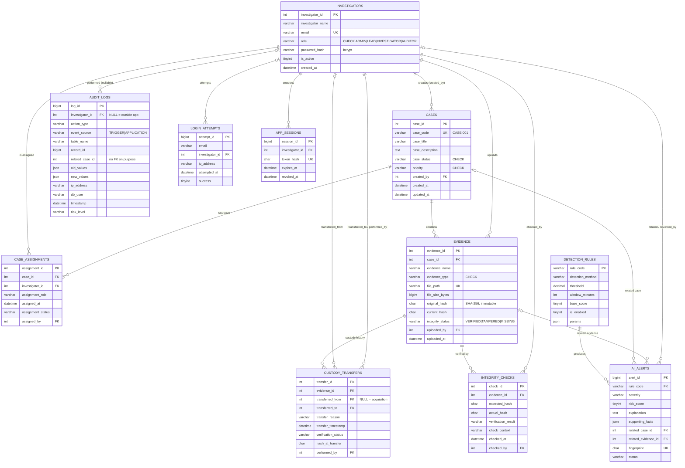

# ER Diagram, Relationships and Normalisation

## 1. Entity-relationship diagram

## 2. Tables

| # | Table | Purpose | Primary key | Foreign keys |
|---|---|---|---|---|
| 1 | investigators | application users and their role | investigator_id | - |
| 2 | cases | investigations | case_id | created_by -> investigators |
| 3 | evidence | registered digital evidence + immutable SHA-256 | evidence_id | case_id -> cases, uploaded_by -> investigators |
| 4 | custody_transfers | chain of custody (append-only) | transfer_id | evidence_id, transferred_from, transferred_to, performed_by |
| 5 | integrity_checks | every SHA-256 verification (append-only) | check_id | evidence_id, checked_by |
| 6 | audit_logs | forensic trail written by triggers (append-only) | log_id | investigator_id (nullable) |
| 7 | case_assignments | which investigator works on which case (M:N) | assignment_id | case_id, investigator_id, assigned_by |
| 8 | login_attempts | brute-force lockout + FAILED_LOGINS detector | attempt_id | investigator_id (nullable) |
| 9 | app_sessions | server-side sessions (token hash only) | session_id | investigator_id |
| 10 | detection_rules | configurable thresholds/scores of detectors | rule_code | - |
| 11 | ai_alerts | findings of the anomaly engine | alert_id | rule_code, related_case_id, related_investigator_id, related_evidence_id, reviewed_by |

Every additional table (8-11) provides a real feature; none exists only to increase the table count.

## 3. Relationships and cardinality

| Relationship | Cardinality | Explanation |
|---|---|---|
| investigators - cases (created_by) | 1 : N | one investigator creates many cases; each case has exactly one creator |
| cases - investigators via case_assignments | M : N | a case has many team members, an investigator works on many cases; resolved by the associative table `case_assignments` with `UNIQUE(case_id, investigator_id)` |
| cases - evidence | 1 : N | evidence always belongs to exactly one case (`case_id NOT NULL`) |
| evidence - custody_transfers | 1 : N | each item has a chronological list of hand-overs (>= 1, the acquisition) |
| investigators - custody_transfers | 1 : N (three roles) | `transferred_from` (0..1, NULL at acquisition), `transferred_to` (1), `performed_by` (1) |
| evidence - integrity_checks | 1 : N | every verification is a new row; nothing is overwritten |
| investigators - audit_logs | 0..1 : N | NULL means the change did not come through the application |
| detection_rules - ai_alerts | 1 : N | each alert is produced by exactly one rule |
| cases / evidence - ai_alerts | 0..1 : N | an alert may relate to a case and/or evidence item |

**Referential actions.** All foreign keys use `ON DELETE RESTRICT`: history may never disappear because a parent row is deleted. (MySQL does **not** fire triggers for rows changed by `ON DELETE CASCADE`, so cascading deletes would also escape auditing - another reason to avoid them. `sp_delete_empty_case` deletes child rows explicitly so each deletion is audited.)

`audit_logs.related_case_id` deliberately has **no** foreign key: an audit record must survive even after the case it describes is deleted (test 4 deletes a case and its DELETE audit row remains).

## 4. Keys and constraints summary

- **11 PRIMARY KEYs** (surrogate `AUTO_INCREMENT` keys, plus the natural key `rule_code`).
- **6 UNIQUE**: `investigators.email`, `cases.case_code`, `evidence.file_path`, `case_assignments(case_id, investigator_id)`, `app_sessions.token_hash`, `ai_alerts.fingerprint`.
- **20 FOREIGN KEYs** with `ON DELETE RESTRICT`.
- **35 CHECK** constraints, e.g. role/status domains, `REGEXP_LIKE(original_hash, '^[0-9a-f]{64}$')`, `transferred_from <> transferred_to`, and the multi-column rule that a `VERIFIED` integrity check must have `actual_hash = expected_hash`.
- **NOT NULL** on every mandatory attribute; **DEFAULT** for statuses, timestamps, roles, priorities.
- **Trigger-enforced rules** (cannot be expressed as CHECK): `original_hash` immutable; `audit_logs`, `integrity_checks`, `custody_transfers` append-only.

## 5. Normalisation

**1NF** - every column holds one atomic value; there are no repeating groups (a case's team is not a comma-separated column but rows in `case_assignments`; checks and transfers are rows, not columns like `check1`, `check2`). Each table has a primary key.

**2NF** - all tables use single-column surrogate keys, so no non-key attribute can depend on *part* of a key. In `case_assignments` the natural key `(case_id, investigator_id)` is protected by UNIQUE and its attributes (`assignment_role`, `assigned_at`, `assignment_status`) depend on the whole pair.

**3NF** - no non-key attribute depends on another non-key attribute:
- Investigator names are **not** repeated in `cases`, `evidence` or `custody_transfers`; only `investigator_id` is stored and names are obtained with JOINs (views `vw_custody_history`, `vw_audit_trail`).
- The case title is not copied into `evidence`; `evidence.case_id` references it.
- The **current custodian is not stored** on `evidence`. It is derived from the latest custody transfer by the function `fn_current_custodian()`, so it can never contradict the history.

**Controlled, documented exceptions**
| Column(s) | Why it is acceptable |
|---|---|
| `evidence.current_hash`, `integrity_status`, `last_verified_at` | Required by the project brief; a cached copy of the latest `integrity_checks` row for fast filtering. Written **only** by `sp_apply_integrity_check` inside the same transaction as the history row, so they cannot diverge. |
| `audit_logs.old_values` / `new_values` (JSON) | A historical *snapshot* of a row at a moment in time. Snapshots must not change when the source row changes, so they are intentionally not normalised. |
| `audit_logs.related_case_id` | Denormalised pointer for fast case timelines; kept without FK so history survives deletion. |
| `ai_alerts.severity` | Derived from `risk_score` with `fn_risk_level()`; stored because alerts are filtered by severity constantly. Both are written together by the detector. |
